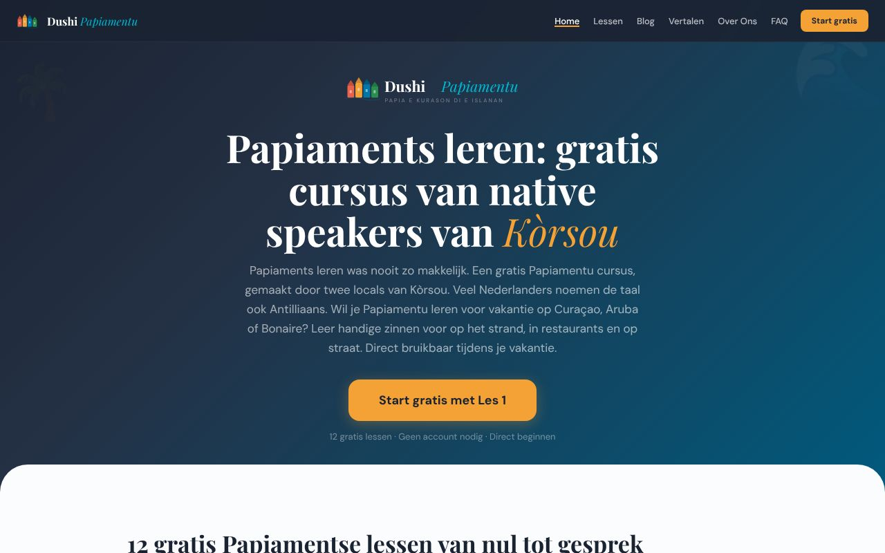
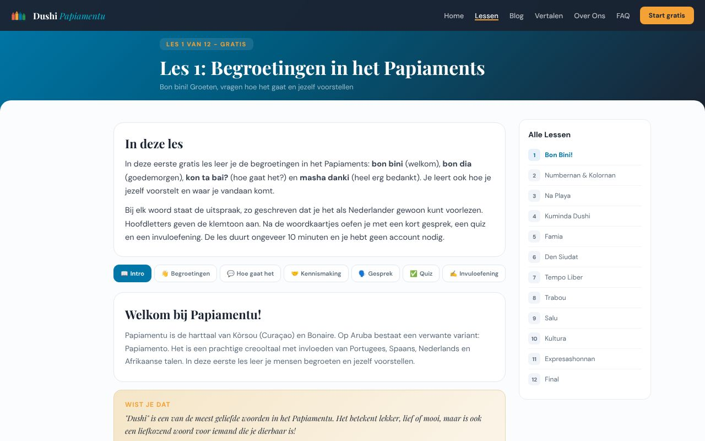
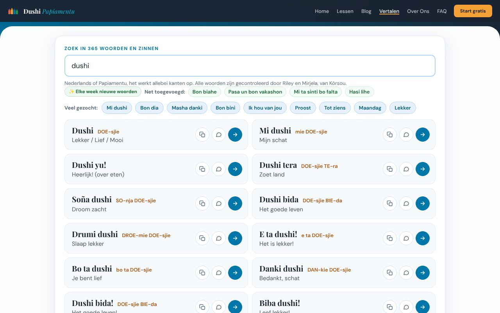
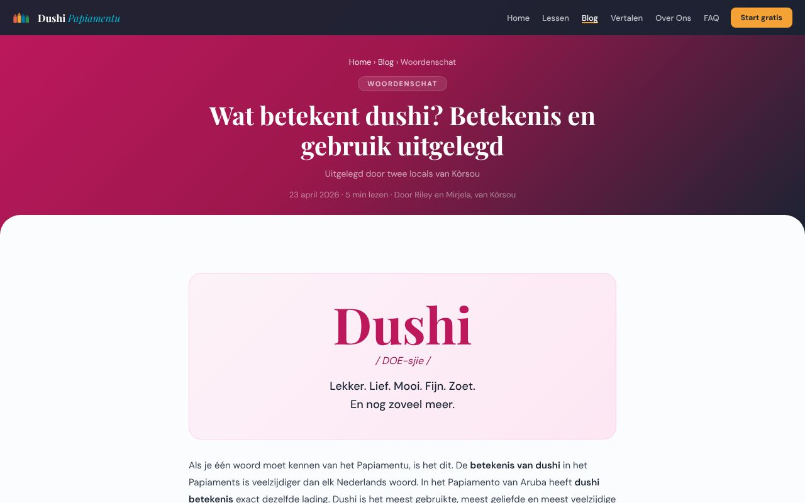
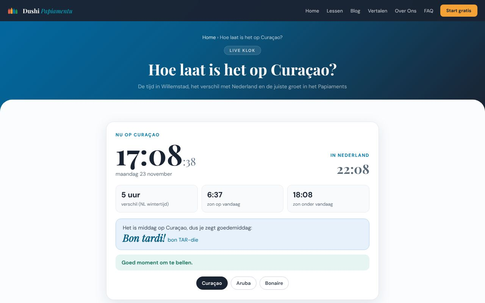
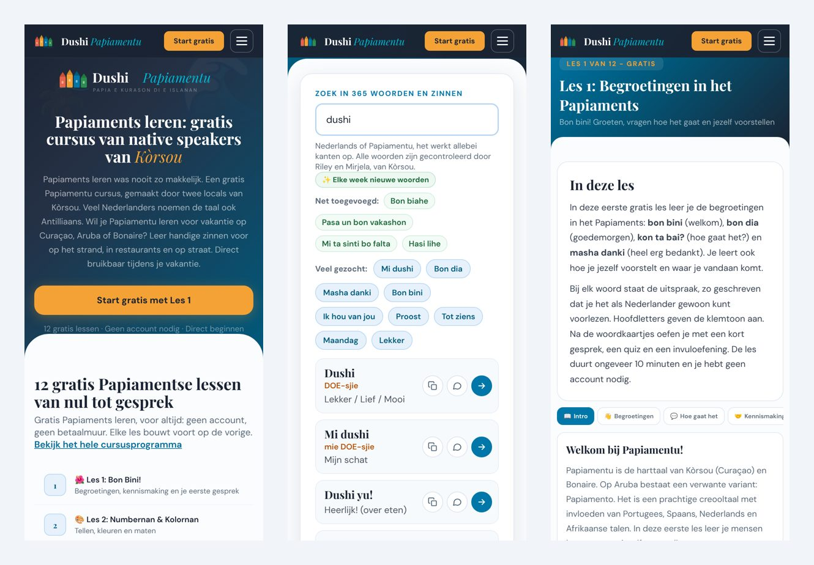

# Dushi Papiamentu

**Gratis Papiaments leren, in het Nederlands.** Twaalf interactieve lessen van nul tot je eerste gesprek, gemaakt door Riley en Mirjela, twee locals van Kòrsou (Curaçao).

👉 **[dushipapiamentu.nl](https://dushipapiamentu.nl)**

## Wat je op de site vindt

- **[Gratis cursus Papiaments](https://dushipapiamentu.nl/cursus-papiaments):** 12 lessen met woordkaarten, uitspraak, gesprekken, een quiz en een certificaat. Geen account nodig.
- **[Papiaments vertalen](https://dushipapiamentu.nl/papiaments-vertalen):** zoek in meer dan 350 woorden en zinnen, Nederlands naar Papiaments en terug, met uitspraak.
- **[Gratis woordenlijst (PDF)](https://dushipapiamentu.nl/blog/papiamentu-woordenlijst-pdf):** meer dan 250 woorden en zinnen om te printen.
- **[Blog](https://dushipapiamentu.nl/blog/):** wat betekent *dushi*, *bon dia* en *masha danki*, eten op Curaçao, Antilliaanse kerst, Sinterklaas op Curaçao en meer.
- **Handige tools:** [hoe laat is het op Curaçao](https://dushipapiamentu.nl/hoe-laat-is-het-op-curacao), [Aruba](https://dushipapiamentu.nl/hoe-laat-is-het-op-aruba) en [Bonaire](https://dushipapiamentu.nl/hoe-laat-is-het-op-bonaire), en een [kerstkaart in het Papiaments](https://dushipapiamentu.nl/wenskaart-bon-pasku).

## Zo ziet het eruit

<table>
<tr>
<td width="50%"> <b>Gratis lessen</b>: uitleg, woordkaarten, uitspraak en een quiz</td>
<td width="50%"> <b>Vertaaltool</b>: Nederlands en Papiaments, met uitspraak</td>
</tr>
<tr>
<td> <b>Blog</b>: woorden, eten en cultuur van Kòrsou</td>
<td> <b>Wenskaart</b>: een kerstkaart in het Papiaments</td>
</tr>
<tr>
<td> <b>Live klok</b>: de tijd op Curaçao, Aruba en Bonaire, met de juiste groet</td>
<td> <b>Op je telefoon</b>: de hele site werkt mobiel</td>
</tr>
</table>

## Over het Papiaments

Papiamentu is de taal van Curaçao en Bonaire. Op Aruba heet hij Papiamento en wordt hij anders gespeld. Deze site gebruikt de spelling van Curaçao, volgens de officiële woordenlijst van de overheid van Curaçao.

## Elke week een eilandtip

Op dinsdagavond sturen we een korte mail met een woord, een zin of een gewoonte van het eiland. [Meld je gratis aan](https://dushipapiamentu.nl/).

## Volg ons

[YouTube](https://www.youtube.com/@Dushipapiamentu) · [Instagram](https://www.instagram.com/dushipapiamentu/) · [Facebook](https://www.facebook.com/dushipapiamentulessen) · [Pinterest](https://nl.pinterest.com/dushipapiamentu/)

---

*De site is gebouwd met gewone HTML, CSS en JavaScript, zonder frameworks, zodat hij ook op een trage verbinding snel laadt. Gehost op Cloudflare Pages.*

© Dushi Papiamentu. De teksten, lessen en afbeeldingen zijn niet vrij te gebruiken zonder toestemming.
